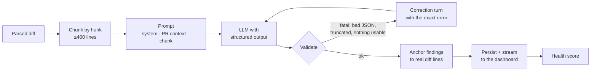

# ReviewMind AI Engine

How a pull request becomes a list of trustworthy, line-anchored review comments — and where that process can still go wrong.



Code map: `app/review/prompts.py` (prompt), `app/review/schema.py` (output contract), `app/review/validation.py` (validation + retry messages), `app/review/engine.py` (orchestration), `app/review/scoring.py` (health score), `app/llm/` (providers, pricing).

---

## 1. Prompt design

### Three layers, ordered for caching

| Layer | Content | Changes |
|---|---|---|
| System prompt | Role, categories, severity rubric, diff format, writing rules | Never |
| PR context | Repository, title, author, branches, description, full changed-file list | Once per PR |
| Chunk prompt | One chunk of one file's diff | Every call |

Providers cache prompt prefixes. Keeping the stable text first — and never putting timestamps or IDs in it — means every chunk after the first reads the system prompt and PR context from cache at ~10% of the input price. Claude's minimum cacheable prompt on `claude-opus-5` is 512 tokens, which the system prompt clears on its own.

A subtle detail: a cache entry only becomes readable once the request *writing* it starts responding. Firing eight identical-prefix requests at once would pay to write eight copies. The engine therefore sends the **first call alone**, then fans out the rest with bounded concurrency (`_Run` in `engine.py`).

### The diff format is built for anchoring

Each line is rendered as `<new line number> <marker> <code>`, with the number column **blank for deleted lines**:

```
@@ -10,3 +10,4 @@ def load(user_id):
   10       conn = get_conn()
      -     row = conn.execute('SELECT * FROM users WHERE id = ?', (user_id,))
   11 +     query = f"SELECT * FROM users WHERE id = {user_id}"
   12 +     row = conn.execute(query)
   13       return row
```

The model never has to count lines through a hunk header — a common source of off-by-N comments — and a deleted line visibly has no number to anchor to.

### Recall first, ranking later

The prompt says *report every issue, including uncertain or low-severity ones, with an honest severity and confidence*. Current Claude models follow "only report important issues" literally: they find a bug, judge it below the bar and silently drop it. Precision rises but recall falls. ReviewMind moves filtering out of the model: severity and confidence rank findings, the health score down-weights low-confidence ones, and the developer's accept/dismiss triage does the rest.

### Reasoning before verdict

In the output schema, `comment` and `suggested_fix` come *before* `severity` and `confidence`. Structured-output decoding follows property order, so the model commits to a severity after it has written out why the issue matters, not before.

### Untrusted input

PR titles, descriptions, file names and code are written by the PR author. They're XML-escaped (a description containing `</description>` can't break out of its tag) and the system prompt states they are material to review, not instructions — text in the code that tries to steer the reviewer is itself reported as a security finding. This reduces prompt-injection risk; it does not eliminate it.

---

## 2. Why structured output is enforced

Free-text review output is fine for a human reading a chat window and useless for a product:

- **The UI anchors comments to lines.** That needs an integer that exists in the diff, not "around the loop near the bottom".
- **Filters, badges and analytics need enums.** `severity ∈ {critical, warning, info}` and a fixed category set, or the charts fall apart.
- **The health score is computed, not generated.** It needs typed inputs.

So enforcement happens at two levels:

1. **Constrained decoding.** Claude gets the schema via `output_config.format` (JSON schema); OpenAI via a `strict` JSON-schema text format. The model cannot emit a different shape. The schema avoids keywords these features don't support (`minLength`, `minimum`), and nullable fields use `anyOf` so the same schema works for both vendors.
2. **Re-validation of everything that comes back** (`validation.py`). Constrained decoding does *not* cover: output truncated at the token limit, refusals, a provider or model without schema enforcement, or values that are well-typed but wrong — a `line_number` of 412 in a 30-line diff is a perfectly valid integer.

### Two tiers of failure

| Failure | Example | Reaction |
|---|---|---|
| **Fatal** | Not JSON; top-level array; `findings` missing; truncated output; every finding malformed | Retry with a correction turn |
| **Per-finding** | Unknown severity; line not in the diff | Drop that finding, keep the rest, record why |

Dropping one bad finding instead of retrying the whole chunk is deliberate: throwing away five good comments because a sixth pointed at a deleted line would make the reviewer worse, not safer. If *every* finding is broken, that's a signal the model misunderstood the task — a retry is worth it.

### Line anchoring

A finding whose line isn't in the diff is snapped to the nearest numbered line **within 3 lines**, otherwise dropped. Models reliably land *near* the right line but occasionally one or two off, or on a deleted line. Anything further away is more likely a hallucinated location than an off-by-one. Both snaps and drops are recorded on the file result.

### The retry loop

On a fatal failure the engine appends two turns — the model's own output as the assistant turn, then a user turn quoting the exact validation error ("The response was not valid JSON (Expecting ',' delimiter at line 1, column 212)") — and asks again, up to `LLM_MAX_ATTEMPTS` (default 3). Showing the model its mistake converges far faster than re-sending the same prompt.

Retries are split by cause:

- **Transport failures** (429, 5xx, timeouts, dropped connections) are retried by the vendor SDK with exponential backoff. If they still fail, that one file is marked failed and the review continues.
- **Invalid output** is retried by ReviewMind, as above.
- **Bad credentials or an unknown model** abort the whole review — every file would fail identically.
- **Refusals**: `claude-opus-5` runs safety classifiers that occasionally decline benign security-adjacent code (reviewing an auth change, say). ReviewMind opts into server-side refusal fallbacks (`fallbacks: "default"`), which re-run a declined request on Anthropic's recommended fallback model. If the whole chain still declines, the file is marked failed with the refusal category.

---

## 3. PR health score

A single 0–100 number (`scoring.py`):

```
score = 100 − Σ critical_points − Σ other_points / max(1, √(changed_lines / 100))
points = severity (critical 18 · warning 6 · info 1.5)
       × category (security 1.5 · bug 1.25 · performance 1 · missing-test/complexity 0.8 · style 0.5)
       × confidence (high 1 · medium 0.8 · low 0.5)
```

- **Criticals are absolute** — a SQL injection is disqualifying in a 5-line PR or a 5,000-line one.
- **Everything else is density-based** — ten nits across 2,000 lines is a tidy PR; ten in 20 lines is not.
- **Only live findings count** — dismissing or flagging a false positive updates the score immediately.

Bands: **≥ 80 healthy**, **50–79 needs attention**, **< 50 at risk**. It's a triage heuristic, not a quality metric; the weights are hand-set and would be tuned against real accept/dismiss data.

---

## 4. Cost tracking

Every LLM call — including failed and retried attempts — is stored in `llm_calls` with model, input/output tokens, cache-write and cache-read tokens, latency, outcome and cost. Cost is computed from the provider-reported usage:

```
cost = input × price_in + cache_write × price_in × 1.25 + cache_read × price_in × 0.10 + output × price_out
```

Anthropic list prices are in `app/llm/pricing.py` (`claude-opus-5`: $5 / $25 per million tokens). Other vendors' prices change too often to hardcode: set `LLM_PRICE_INPUT_PER_MTOK` / `LLM_PRICE_OUTPUT_PER_MTOK`, otherwise cost is reported as unknown rather than guessed. Per-review totals are shown in the dashboard; lifetime totals in analytics.

## 5. Configuration

| Variable | Default | Notes |
|---|---|---|
| `ANTHROPIC_API_KEY` | — | Selects Claude when present |
| `OPENAI_API_KEY` | — | Used when no Anthropic key; requires `LLM_MODEL` |
| `LLM_PROVIDER` | `auto` | `anthropic` / `openai` to force one |
| `LLM_MODEL` | `claude-opus-5` | Any model the key can access |
| `LLM_EFFORT` | `high` | Claude effort level. `medium`/`low` are strong on Opus 5 and cut latency and cost — worth measuring |
| `LLM_CONCURRENCY` | `4` | Parallel LLM calls per review |
| `LLM_MAX_ATTEMPTS` | `3` | Validation retries per chunk |
| `CHUNK_MAX_LINES` | `400` | Diff lines per LLM call |

---

## 6. Known limitations

Being explicit about these is part of the design.

- **It cannot run the code.** No tests, no type checker, no execution. Bugs that only appear at runtime — a race under load, a wrong environment variable, an integration mismatch — are mostly invisible to it.
- **It only sees the diff and the file list.** Not the rest of the repository. A change that breaks a caller in an untouched file, or duplicates a helper that already exists elsewhere, will usually be missed. The prompt asks for low confidence when a concern depends on unseen code, but that is a mitigation, not context.
- **It can be confidently wrong.** Line validation catches *where* a hallucinated comment points, not *whether* the claim is true. A well-anchored, plausible, incorrect finding gets through — which is exactly why every finding has Accept / Dismiss / False positive.
- **Large diffs degrade quality.** Chunking keeps each call small, but a 400-line chunk still gets less attention per line than a 40-line one, and related changes split across chunks are reviewed separately. Files over 1,500 changed lines are skipped outright and reported as such.
- **"Missing test" is a heuristic.** The model infers coverage from file names in the PR. It can't see existing tests elsewhere in the repo.
- **Non-deterministic.** Reviewing the same PR twice can produce slightly different findings and scores.
- **Prompt injection is reduced, not solved.** A determined PR author can try to influence the reviewer through the description or code comments.
- **Cost scales with PR size.** Caching helps with the shared prefix; the diff itself is always paid for.
- **Fallback billing is approximate.** When a refusal fallback serves a request, cost is computed from the final attempt's usage at that model's price.

## 7. Improving it over time

The Accept / Dismiss / False-positive buttons aren't just UX — they are labelled evaluation data. With enough of it:

1. **Measure**: false-positive rate by category, severity and file type (the analytics page already shows the first).
2. **Build an eval set** from triaged findings: dismissed-as-false-positive comments become negative examples; accepted ones positive.
3. **Tune against it**: prompt wording, effort level, chunk size, snap distance, and the health-score weights — each change measured, not guessed.
4. **Add context the model is missing**: related files via code search, the repo's lint config, and the team's past accepted comments as few-shot examples.
