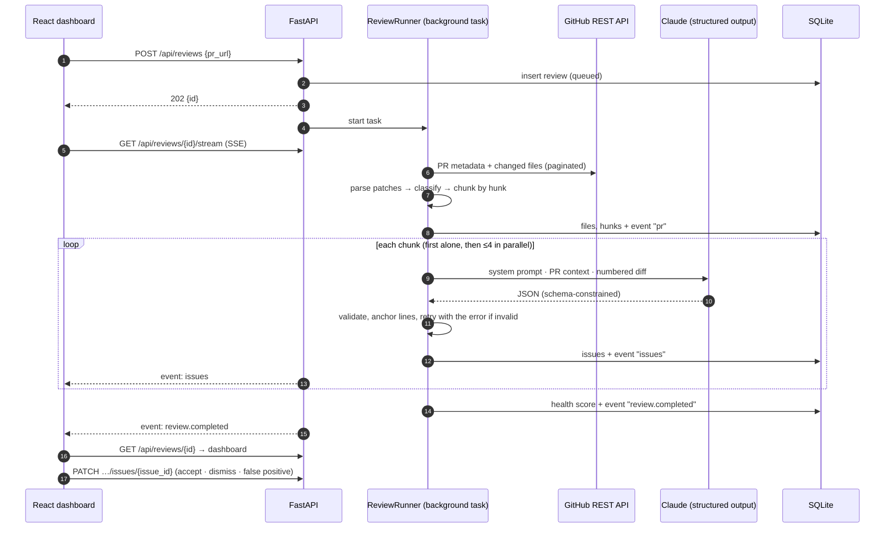

# ReviewMind architecture

One page on how a pull request URL becomes a streamed, line-anchored review, and why each piece is shaped the way it is.

## The flow

## Layers

| Layer | Module | Responsibility |
|---|---|---|
| GitHub | `app/github/` | Parse PR references; async read-only client with typed errors (404 / 401 / rate limit) and pagination. |
| Diff | `app/diff/` | Unified-diff parser with old/new line numbers; skip rules for lockfiles, generated, vendored, assets, docs; hunk-boundary chunking. |
| LLM | `app/llm/` | `LLMProvider` protocol with Claude and OpenAI implementations; pricing and cost estimation. |
| Review | `app/review/` | Prompts, output schema, two-tier validation, retry loop, concurrency + cache warm-up, health score. |
| Services | `app/services/` | `ReviewRunner` (background orchestration and persistence), read models, token lookup. |
| API | `app/api/` | Reviews, SSE stream, issue triage, repositories, analytics, webhook, sample data. |
| Storage | `app/models.py`, `app/db.py` | SQLAlchemy 2.0 async on SQLite (WAL). |
| UI | `frontend/src/` | React + TypeScript + Tailwind + Framer Motion; TanStack Query for server state, `EventSource` for the stream. |

## Data model

`repositories` (encrypted token) ─< `reviews` ─< `review_files` (hunks as JSON) ─< `issues`
and, per review, `review_events` (the stream log) and `llm_calls` (tokens, cost, latency and outcome of every attempt).

## Decisions worth defending

**Server-Sent Events, not WebSockets.** Updates flow one way: server to browser. SSE is plain HTTP (works through proxies, needs no upgrade handshake), and `EventSource` reconnects on its own and resends `Last-Event-ID`. Triage actions are ordinary `PATCH` requests, so nothing needs a bidirectional socket.

**The event log is written before it's published.** Each step changes rows and appends a `review_events` row in one transaction, commits, then publishes to in-memory subscribers. A client connecting late, or reconnecting, replays from the table, then switches to the live queue (it subscribes *before* reading the log, so nothing falls in between). The same log powers "Replay stream" on finished reviews.

**SQLite with WAL.** Zero setup for a local tool, and WAL lets the dashboard read while a review writes. Counters that concurrent file workers update (`files_done`, token totals) are incremented in SQL, never read-modified-written. Moving to Postgres is a `DATABASE_URL` change plus migrations.

**In-process background tasks.** Reviews run as `asyncio` tasks owned by `ReviewRunner`. Simple and adequate for one process; on startup, reviews left `queued`/`reviewing` by a crash are marked failed with a clear message rather than spinning forever. A deployment with multiple workers would move this to a queue (arq, Celery) and the broker to Redis pub/sub.

**Chunk by hunk, cache the prefix.** Files are split at hunk boundaries (≤400 diff lines per call), so the model never sees half a change. The system prompt and PR context form a stable prefix that Claude caches; the first call runs alone so every later call reads that cache instead of each paying to write it.

**Structured output plus validation.** The schema is enforced during decoding, and everything is still re-validated: truncation, refusals and wrong-but-well-typed values (a line not in the diff) can't be caught by the schema. Details in [AI_ENGINE.md](AI_ENGINE.md).

**Tokens encrypted at rest.** Repository tokens are Fernet-encrypted with a key kept outside the database (`SECRET_KEY`, or a generated `data/secret.key` with 0600 permissions). The API only ever returns whether a token exists and its last four characters.

## Failure handling

| Failure | Behaviour |
|---|---|
| PR not found / private without access | Review fails with GitHub's reason; stream ends with `review.failed`. |
| GitHub rate limit | Typed error including reset time and a hint to add a token. |
| LLM 429 / 5xx / timeout | Retried by the SDK with backoff; if still failing, that file is marked failed and the review continues. |
| Malformed or truncated model output | Retried with the validation error as a correction turn (up to 3 attempts); visible as `file.retry` events. |
| Invalid API key or unknown model | Whole review aborts, every file would fail identically. |
| Every file fails | Review is marked failed, not "completed with score 100". |
| API restarts mid-review | Review marked failed on startup: "Interrupted: the API restarted…". |
| Browser disconnects | `EventSource` reconnects with `Last-Event-ID` and receives only what it missed. |
