# ReviewMind

**AI pull request reviews that point at the exact line.** Paste a GitHub PR and ReviewMind reads the diff file by file, asks Claude for structured findings — bugs, security risks, performance problems, missing tests, complexity, style — validates every one against the real diff, and streams them into a review dashboard where you accept, dismiss or flag each suggestion.

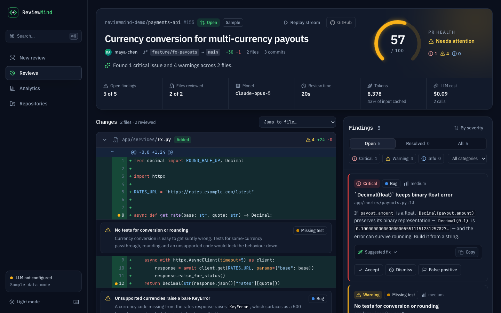

> Runs locally. Without an API key it opens in **sample mode**: clearly labelled, hand-written sample reviews (never presented as model output) so the whole interface can be explored first.

## The problem

Human review is the slowest step between writing code and shipping it, and much of a first pass is mechanical: an unparameterised query, a missing null check, a new branch with no test. An automated first pass lets reviewers spend their attention on design.

Most "AI code review" demos paste model text into a box. That is hard to act on: comments aren't tied to lines, there's no way to tell the tool it was wrong, and nobody knows what it cost. ReviewMind treats model output as data — **typed, validated, anchored to a line, triaged by a human, and measured**.

## Features

- **Live streaming review.** A per-file checklist lights up as each file is analysed and findings animate into a feed as they're produced, over Server-Sent Events. Output that fails validation is retried visibly.
- **Line-anchored dashboard.** A syntax-highlighted diff with comment threads inline under the lines they refer to, beside a panel of finding cards: severity, category, model confidence, explanation, and a suggested fix with one-click copy.
- **Triage that teaches.** Accept, dismiss or flag each finding as a false positive (with undo). The PR health score recalculates immediately, and every verdict feeds the precision analytics.
- **PR health score.** One 0–100 number on an animated gauge that shifts green → amber → red. Critical issues cost fixed points; everything else scales with PR size.
- **Analytics.** Health trend, findings by category and by week, per-category reviewer precision, false-positive rate, estimated review time saved, and LLM spend. Every chart has a table view.
- **Repositories.** Per-repository average health and sparklines. An optional access token for private repositories is encrypted at rest.
- **Cost tracking.** Every LLM call is stored with input, output and prompt-cache tokens, latency, outcome and cost.
- **Keyboard first.** `j`/`k` to move, `a` accept, `d` dismiss, `f` false positive, `c` copy fix, `⌘K` command menu.
- **Polish.** Dark by default with a light theme, responsive down to phone widths, loading skeletons, toasts, designed empty states, and reduced-motion support.
- **Webhook (stretch goal).** Automatically review pull requests opened on tracked repositories, with HMAC-verified deliveries.

## Screenshots

| Live streaming review | Analytics |
|---|---|
| 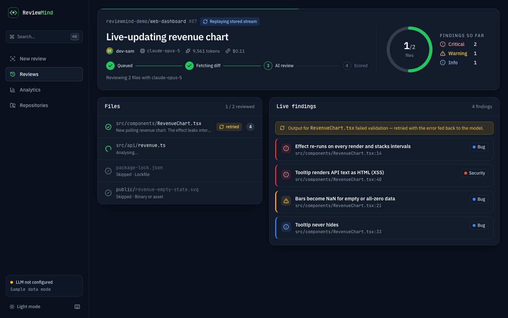 | 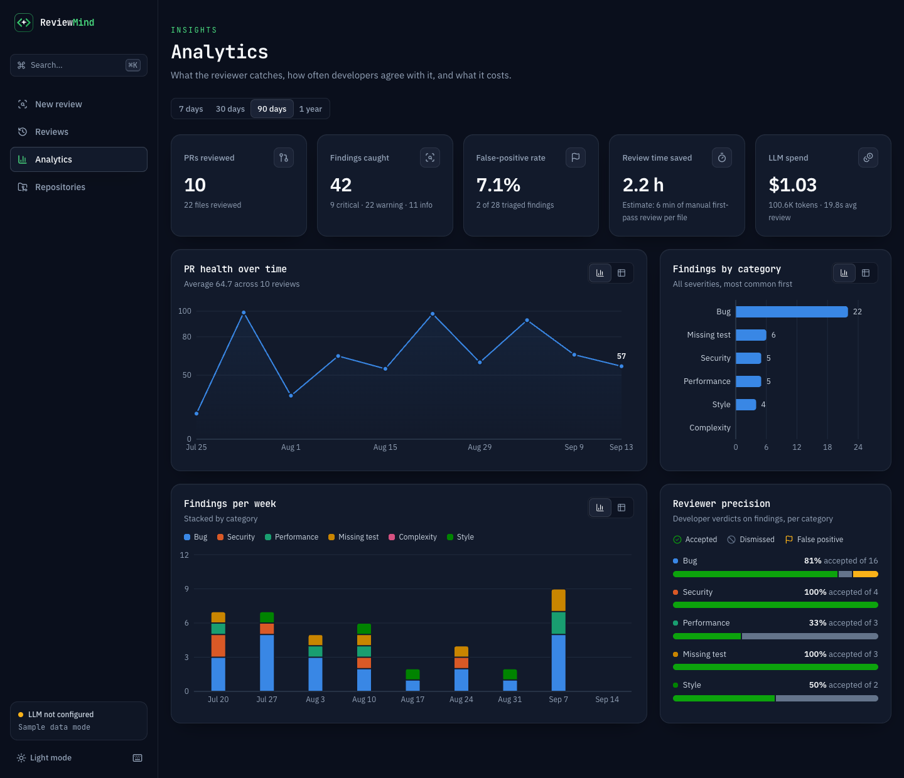 |
| **Keyboard triage** — `j` to select, `a` to accept, with undo | **Repositories** |
| 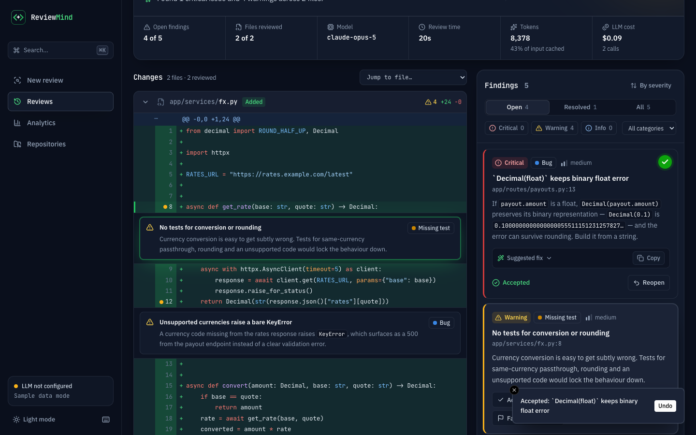 | 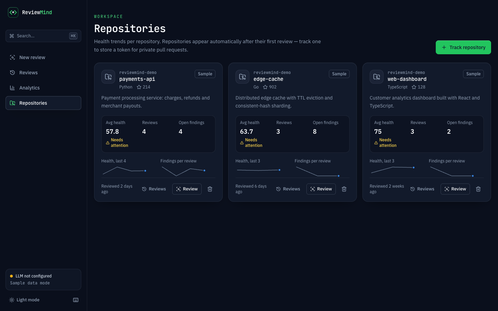 |
| **Light theme** | **Command menu** |
| 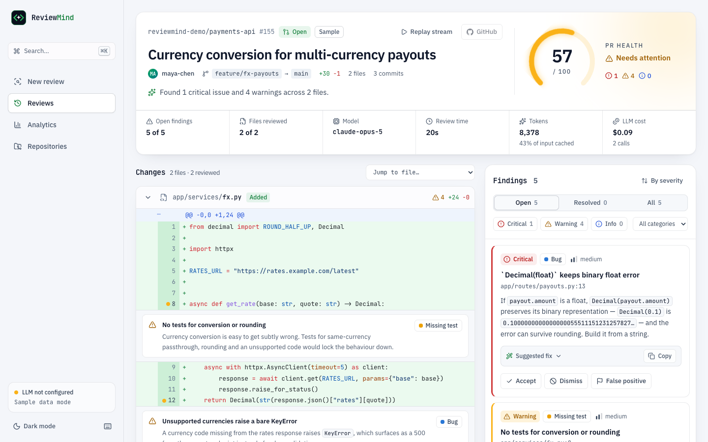 | 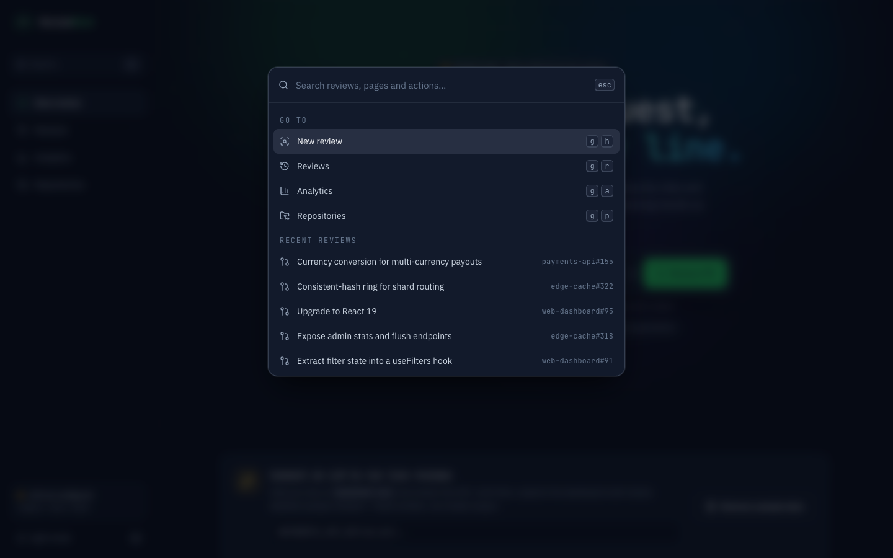 |
| **Home** | **On a phone** |
| 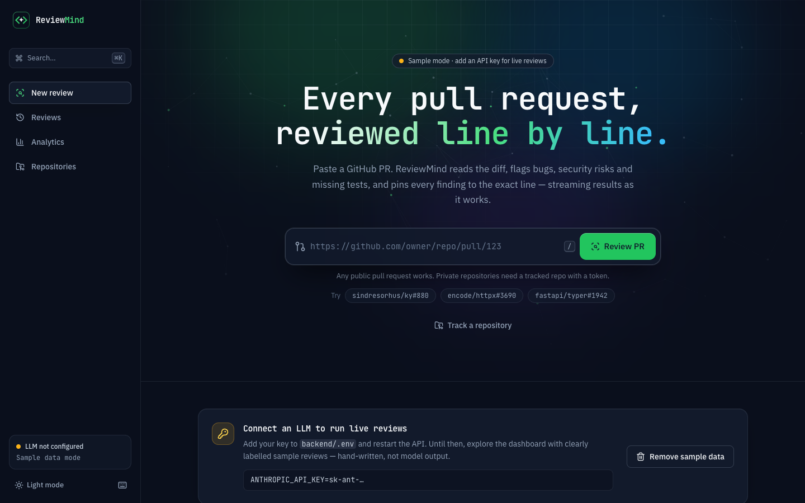 | 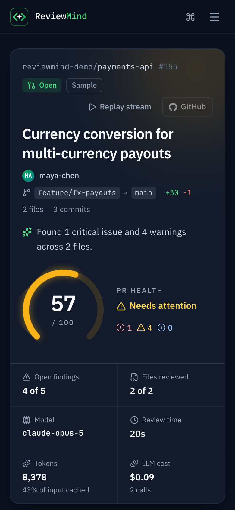 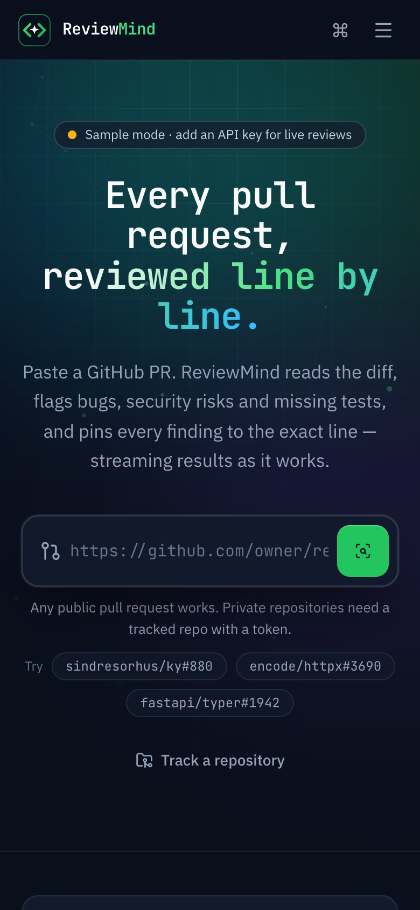 |

## Architecture

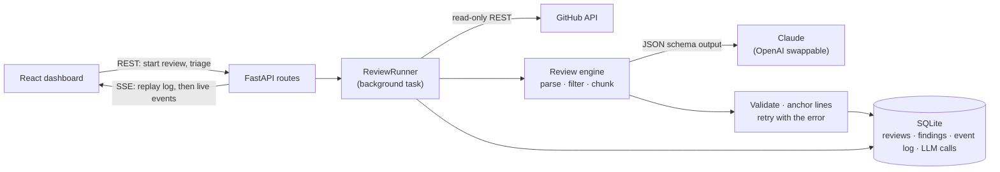

**PR URL → GitHub fetch → diff parsing and filtering → chunking at hunk boundaries → LLM with structured output → validation and line anchoring → storage → stream to the UI.**

- [ARCHITECTURE.md](ARCHITECTURE.md) — the request flow, data model, design decisions and failure handling.
- [AI_ENGINE.md](AI_ENGINE.md) — prompt design, why structured output is enforced, the retry strategy, scoring, cost tracking and limitations.

## Tech stack, and why

| Layer | Choice | Why |
|---|---|---|
| API | **FastAPI + Pydantic** | The work is I/O-bound fan-out to GitHub and the LLM, which suits async. Typed models also generate clean Swagger docs at `/docs`. |
| GitHub | **httpx (async)** | PyGithub is synchronous and would block the event loop during every fetch. |
| LLM | **Claude (`claude-opus-5`)** behind an `LLMProvider` interface | Structured outputs enforce the JSON schema while decoding. An OpenAI implementation is included, so switching vendor is configuration. |
| Storage | **SQLite** via async SQLAlchemy 2.0 | Zero setup for a local tool, and WAL mode lets the dashboard read while a review writes. Reviews, files and findings are relational, and analytics are aggregate queries. Postgres is a URL change. |
| Streaming | **Server-Sent Events** | Updates only flow server → browser. SSE is plain HTTP, and `EventSource` reconnects on its own with `Last-Event-ID`. |
| UI | **React 19, Vite, TypeScript, Tailwind CSS v4, Framer Motion** | Fast iteration, typed API contracts, one motion vocabulary built on springs. |
| Diff view | **Custom component + Shiki** | Comment threads must render *between* diff lines, anchored to new-file line numbers. Shiki uses VS Code's grammars with dual-theme tokens. Monaco would add megabytes for an editor that isn't needed. |
| Charts | **Recharts** | The categorical palette is validated for colour-vision deficiency, and every chart has a table twin. |
| Design | **ui-ux-pro-max** design system | Generated tokens, typography and UX rules live in [`design-system/reviewmind/MASTER.md`](design-system/reviewmind/MASTER.md), with overrides recorded in [`DECISIONS.md`](design-system/reviewmind/DECISIONS.md). |

## Run it locally

Prerequisites: **Python 3.12+** and **Node.js 20+**.

**1. Backend** (terminal 1)

```bash
cd backend
python3 -m venv .venv
.venv/bin/pip install -r requirements-dev.txt
cp .env.example .env
.venv/bin/uvicorn app.main:app --reload --port 8000
```

Interactive API docs are at http://127.0.0.1:8000/docs.

**2. Frontend** (terminal 2)

```bash
cd frontend
npm install
npm run dev
```

Open **http://localhost:5173**. The dev server proxies `/api` to the backend, so no CORS setup is needed.

**3. Keys.** Both are optional: the app starts in sample mode without them.

- **LLM API key.** In the Anthropic Console, open *Settings → API keys → Create key* and add it to `backend/.env` as `ANTHROPIC_API_KEY=…`, then restart the backend. To use OpenAI instead, set `OPENAI_API_KEY` and `LLM_MODEL`.
- **GitHub token.** Public pull requests work without one, at GitHub's anonymous limit of 60 requests/hour; each review uses two or more. A token raises that to 5,000/hour and is required for private repositories. On GitHub, open *Settings → Developer settings → Personal access tokens → Fine-grained tokens*, and grant read-only **Pull requests** and **Contents** access. Put it in `backend/.env` as `GITHUB_TOKEN=…`, or attach it to a single repository from the Repositories page.

### Configuration

All settings live in `backend/.env`; see [`.env.example`](backend/.env.example).

| Variable | Default | Purpose |
|---|---|---|
| `ANTHROPIC_API_KEY` | — | Enables live reviews with Claude |
| `OPENAI_API_KEY` | — | Alternative provider (requires `LLM_MODEL`) |
| `LLM_MODEL` | `claude-opus-5` | Model used for reviews |
| `LLM_EFFORT` | `high` | Claude effort level; `medium` is cheaper and faster |
| `LLM_CONCURRENCY` | `4` | Parallel LLM calls per review |
| `GITHUB_TOKEN` | — | Default GitHub token |
| `SECRET_KEY` | generated | Fernet key that encrypts stored tokens |
| `GITHUB_WEBHOOK_SECRET` | — | Enables `POST /api/github/webhook` |

## Security practices

- **Secrets stay out of the repository.** Keys and tokens live only in `backend/.env`, which is git-ignored; `.env.example` holds placeholders. In any deployment they belong in the platform's secret store, never in code.
- **Tokens encrypted at rest.** Repository tokens are Fernet-encrypted with a key kept outside the database, and the API only ever returns *whether* a token exists and its last four characters.
- **Least privilege.** ReviewMind never writes to GitHub, so a read-only token is all it needs.
- **Verified webhooks.** Webhook deliveries are checked with HMAC-SHA256 using a constant-time comparison, and unsigned requests are rejected.
- **Untrusted input.** Pull request text is escaped in prompts and explicitly marked as data, not instructions. Model output is rendered as text, never as HTML.

## Testing

```bash
cd backend
.venv/bin/pytest
```

The suite covers the diff parser, chunking, file classification and reference parsing, and **LLM output validation and retries**: malformed JSON, truncated output, findings on lines outside the diff, and all-invalid responses that trigger a correction turn. It also tests the review engine's concurrency and cache warm-up, both providers against mocked SDKs, and the full HTTP API with a scripted LLM, including SSE replay and resume, triage, repositories, analytics, webhook signatures, restart recovery and token encryption.

Live tests are opt-in because they hit real services:

```bash
RUN_LIVE_TESTS=1 .venv/bin/pytest tests/test_live_github.py tests/test_live_review.py
```

`test_live_github.py` checks parsed diffs against GitHub's own line counts on real merged PRs. `test_live_review.py` runs the **whole pipeline end to end** on a small real PR — GitHub, your LLM key, database, API and stream — and costs a few cents.

Frontend checks:

```bash
cd frontend
npm run build
npm run lint
```

## Keyboard shortcuts

| Keys | Action | Keys | Action |
|---|---|---|---|
| `j` / `k` | Next / previous finding | `⌘K` | Command menu |
| `a` | Accept | `?` | All shortcuts |
| `d` | Dismiss | `t` | Toggle theme |
| `f` | Flag false positive | `g` then `h` / `r` / `a` / `p` | Go to home / reviews / analytics / repositories |
| `u` | Reopen | `/` | Focus the PR input |
| `c` | Copy suggested fix | `Esc` | Clear selection |

## API

| Method | Path | Purpose |
|---|---|---|
| `POST` | `/api/reviews` | Start a review for a PR URL (returns immediately) |
| `GET` | `/api/reviews` | List reviews (filter by repository or status) |
| `GET` | `/api/reviews/{id}` | Files, diffs, findings, health score, tokens and cost |
| `GET` | `/api/reviews/{id}/stream` | Server-Sent Events: progress and findings as they're produced |
| `PATCH` | `/api/reviews/{id}/issues/{issue_id}` | Accept, dismiss or flag a finding; returns the new score |
| `POST` / `GET` / `DELETE` | `/api/repos` | Track repositories, with an optional encrypted token |
| `GET` | `/api/analytics/summary` | Totals, trends, categories, precision and cost |
| `POST` | `/api/github/webhook` | Auto-review PRs on tracked repositories |
| `GET` | `/api/health` | LLM and GitHub configuration status |

## Limitations

ReviewMind is a first-pass reviewer, not a replacement for one. It **cannot run the code**, so runtime-only bugs mostly escape it. It **only sees the diff and the list of changed files**, not the rest of the repository. It **can be confidently wrong**: line validation catches *where* a finding points, not *whether* it's true, which is exactly why every finding has Accept / Dismiss / False positive. Very large diffs get less attention per line, results vary slightly between runs, and prompt injection through PR text is reduced, not solved. The details are in [AI_ENGINE.md](AI_ENGINE.md#6-known-limitations).

## What I'd improve with more time

- **Write back to GitHub.** Post accepted findings as review comments through a GitHub App with write scope.
- **More context.** Retrieve callers and related files through code search, so cross-file bugs become visible.
- **Learn from triage.** Turn accepted and false-positive verdicts into an evaluation set; tune prompt wording, effort, chunk size and score weights against it; use the team's past accepted comments as few-shot examples, and eventually fine-tune.
- **A verification pass.** Add a second, cheaper pass that re-checks each finding and drops likely false positives before they reach the developer.
- **Incremental re-review.** On new pushes, review only the hunks that changed since the last reviewed commit.
- **Scale out.** Move to a durable job queue with Redis pub/sub for multiple workers, and Postgres with migrations.
- **Teams.** Authentication, and workspaces per user or team.
- **Deployment.** Containerise and host it. The project is deliberately local-only for now.

## Project structure

```
reviewmind/
├── backend/
│   ├── app/
│   │   ├── github/      # PR reference parsing, async read-only GitHub client
│   │   ├── diff/        # unified-diff parser, skip rules, hunk chunking
│   │   ├── llm/         # provider interface, Claude + OpenAI, pricing
│   │   ├── review/      # prompts, output schema, validation, engine, health score
│   │   ├── services/    # background runner, persistence, read models
│   │   ├── api/routes/  # reviews + SSE, repos, analytics, webhook, sample data
│   │   └── demo/        # hand-written sample reviews
│   └── tests/
├── frontend/src/
│   ├── components/      # review (diff viewer, issue cards, gauge, live view), charts, layout, ui
│   ├── pages/           # home, reviews, review, analytics, repositories
│   └── lib/             # API client, SSE hook, syntax highlighting, hotkeys, theme
├── design-system/       # ui-ux-pro-max design system and overrides
├── docs/screenshots/
├── AI_ENGINE.md
└── ARCHITECTURE.md
```
